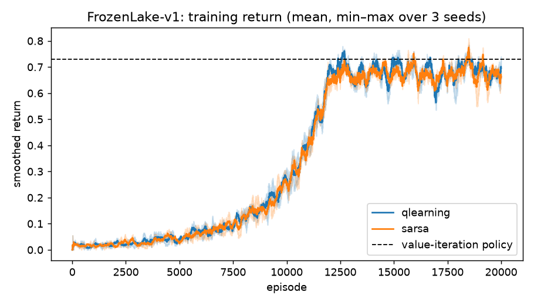

# Reinforcement Learning from Scratch: Summer of Science 2026

Implementations of the core reinforcement learning algorithms I studied in **Summer of Science** (Maths & Physics Club, IIT Bombay), written from scratch in **NumPy and PyTorch** and benchmarked on Gymnasium environments over **3 random seeds**.

| Family | Algorithms | Environments |
|---|---|---|
| Dynamic programming | Value iteration (optimal reference) | FrozenLake, Taxi, CliffWalking |
| Tabular TD control | Q-learning, SARSA | FrozenLake 4×4 (slippery), Taxi, CliffWalking |
| Value-based deep RL | DQN, Double DQN, and ablations | CartPole |
| Policy gradient | REINFORCE (with baseline), A2C, PPO | CartPole, LunarLander |
| Continuous control | DDPG | Pendulum |

No RL libraries are used: every update rule (Bellman backups, TD targets, replay buffer, target networks, GAE, PPO clipping, Polyak averaging) is implemented explicitly in [`rl/`](rl).

---

## Results

All numbers below were produced by the scripts in this repo (`results/*.csv`). "Greedy eval" is the mean return of the trained policy acting greedily, without exploration, on fresh episodes. Values are mean ± std over 3 seeds.

### Tabular methods

| Environment | Value iteration (optimal) | Q-learning | SARSA |
|---|---|---|---|
| FrozenLake 4×4, slippery (success rate) | 0.729 | 0.734 ± 0.004 | 0.727 ± 0.001 |
| Taxi (return) | 7.91 | 7.91 ± 0.00 | 7.72 ± 0.09 |
| CliffWalking (return) | −13 | −13 ± 0 | −17 ± 0 |

**CliffWalking shows the classic on- vs off-policy difference.** Q-learning learns the optimal path along the cliff edge (−13). SARSA learns the values of the ε-greedy policy it actually follows, so it prefers a *safer* route one row away from the cliff (−17). On FrozenLake, both TD methods match the value-iteration optimum within evaluation noise. Evaluation uses 1,000 stochastic episodes, so Q-learning's 0.734 versus the optimal 0.729 is sampling noise, not a better policy.

<p align="center"> </p>

### Deep RL on CartPole-v1 (max return 500)

| Algorithm | Training return (last 20 eps) | Greedy eval |
|---|---|---|
| DQN | 235.7 ± 24.4 | 235.1 ± 70.6 |
| REINFORCE (learned baseline) | 418.4 ± 60.2 | **500.0 ± 0.0** |
| A2C | 299.7 ± 119.6 | 387.8 ± 158.7 |
| PPO | **500.0 ± 0.0** | **500.0 ± 0.0** |

PPO solved CartPole on every seed and stayed stable. REINFORCE also reaches a perfect greedy policy, but its training curve oscillates heavily, which is the high-variance Monte-Carlo gradient in action. A2C solved 2 of 3 seeds. Seed 2 collapsed late in training, a known sensitivity of single-environment A2C.

<p align="center"></p>

### Ablation study: why DQN needs replay and a target network

| Variant | Training return | Greedy eval |
|---|---|---|
| DQN (replay + target network) | 292.6 ± 101.2 | 254.7 ± 178.4 |
| Double DQN | 265.2 ± 42.1 | **447.2 ± 40.4** |
| No replay buffer (learn from the latest 64 correlated transitions) | 165.3 ± 69.4 | 139.4 ± 24.0 |
| **No target network** | **9.3 ± 0.1** | **9.2 ± 0.1** |

- **Removing the target network makes learning diverge completely.** Bootstrapping from the same network that is being updated creates a feedback loop. Q-value estimates grew to about 8 × 10⁶, against about 34 with a target network, and the policy degenerated to pushing in one direction, failing in about 9 steps.
- **Removing experience replay** roughly halves performance, because consecutive transitions are highly correlated.
- **Double DQN** gives the most reliable greedy policy (447 vs 255), consistent with its reduced over-estimation bias.

<p align="center"></p>

### Harder environments

| Environment | Algorithm | Training return | Greedy eval | Notes |
|---|---|---|---|---|
| LunarLander-v3 | PPO (1M steps) | 203.0 ± 58.0 | **245.0 ± 25.8** | ≥ 200 counts as solved; all 3 seeds pass |
| Pendulum-v1 | DDPG (30k steps) | −142.4 ± 11.0 | −146.7 ± 2.3 | Random policy ≈ −1200; around −150 swings up and balances |

<p align="center"> </p>

---

## Repository layout

```
rl/
  tabular.py          value iteration, Q-learning, SARSA, ε-greedy, greedy evaluation
  dqn.py              DQN / Double DQN with replay buffer + target network (ablation flags)
  policy_gradient.py  REINFORCE (+baseline), A2C, PPO (clipped objective, GAE)
  ddpg.py             DDPG with Gaussian exploration and Polyak-averaged targets
  common.py           MLP builder, seeding, smoothing, env-version helper
scripts/
  run_tabular.py      tabular experiments → results/tabular_*
  run_deep.py         deep RL experiments (parallel over seeds) → results/deep_*
results/              plots, summary CSVs, raw per-episode returns (results/raw/*.json)
```

## Reproduce

```bash
python -m venv .venv && .venv\Scripts\activate      # Windows  (source .venv/bin/activate on Linux/macOS)
pip install -r requirements.txt
python scripts/run_tabular.py                         # ~3 min on CPU
python scripts/run_deep.py all                        # ~25 min on a 16-core CPU; or: cartpole | ablation | pendulum | lunar
```

Every run is seeded (seeds 0, 1, 2), and the hyperparameters are the defaults in each `train_*` function.

## What I learned

- **On- vs off-policy:** SARSA's caution on CliffWalking happens because it evaluates the policy it actually follows.
- **The "deadly triad":** function approximation, bootstrapping and off-policy learning together diverge without stabilisers. The no-target-network ablation shows this directly.
- **Variance reduction:** baselines, GAE and PPO's clipped trust region turn noisy policy gradients into stable learning.
- **Engineering details matter:** treating time-limit truncation differently from true termination, clipping gradients and seeding correctly all changed the results.

The theory behind these algorithms (MDPs, Bellman equations, DP, TD learning, policy gradients, RLHF) is written up in my Summer of Science end-term report.

## References

Sutton & Barto, *Reinforcement Learning: An Introduction* (2nd ed.) · Mnih et al., *Human-level control through deep RL* (2015) · van Hasselt et al., *Double Q-learning* (2016) · Schulman et al., *PPO* (2017) and *GAE* (2016) · Lillicrap et al., *DDPG* (2016)

---
Manas Jagtap · Dual Degree, Electrical Engineering, IIT Bombay
