# Reinforcement Learning: Theory, Algorithms and Applications
### Summer of Science 2026 · Maths & Physics Club, IIT Bombay

Code, theory notes and experiments following my 8-week **Plan of Action**, from the probability refresher and bandits up to DQN, PPO, DDPG, RLHF and multi-agent RL. Every algorithm is **implemented from scratch** in NumPy and PyTorch (no RL libraries), and every number below was produced by the scripts in this repo, **over 3 random seeds**.

> **Note:** my original Summer of Science code was lost, so in October 2026 I re-implemented and re-ran everything following my Plan of Action and end-term report. All results were regenerated from scratch.

**Certificate of completion:** reading project in Reinforcement Learning, Summer of Science 2026, Maths & Physics Club, IIT Bombay ([PDF](certificate/summer-of-science-2026-certificate.pdf)).

<p align="center">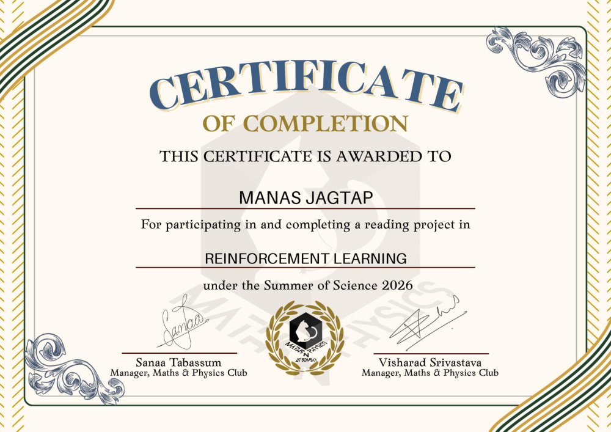</p>

## Highlights

| | Result |
|---|---|
| Bellman equation | Closed-form $(I-\gamma P_\pi)^{-1}r_\pi$ and iterative policy evaluation agree to **2.7 × 10⁻¹²**; the measured contraction factor **0.776 ≤ γ = 0.9** |
| Dynamic programming | Policy iteration converges in **3 improvement steps** vs **571 sweeps** for value iteration, with the same $v^*$ (to 3 × 10⁻⁹) |
| TD vs Monte Carlo | TD(0) reaches **51% lower RMS error** than constant-α MC on the random walk |
| Bandits | UCB picks the optimal arm **85.6%** of the time vs **34.7%** for greedy (10-armed testbed, 2,000 runs) |
| DQN ablation | Removing the target network makes DQN **diverge**: Q-values reach **8.4 × 10⁶** against a theoretical bound of 100, and the return collapses to 9 |
| Double DQN | Greedy return **447 ± 40 vs 255 ± 178** for vanilla DQN on CartPole |
| Variance reduction | A learned baseline cuts REINFORCE gradient variance by **28–54%** without changing its direction (cosine similarity ≥ 0.99) |
| PPO | Solved CartPole on **3/3 seeds** in a median of **38.7k steps**, 32% fewer than REINFORCE; solved LunarLander (**245 ± 26**) on 3/3 seeds |
| DDPG | Pendulum swing-up: **−147 ± 2** (a random policy scores about −1200) |
| RLHF | A Bradley–Terry reward model ranks **96.7%** of response pairs correctly from 5,000 preferences |
| MARL | Fictitious play converges to the matching-pennies mixed Nash equilibrium (**0.498 / 0.498** vs 0.5) |

## Plan of Action → this repo

| Week | Topic | Theory | Code | Results |
|---|---|---|---|---|
| 1 | RL orientation, probability refresher | [01](theory/01_rl_basics_and_probability.md) | — | — |
| 2 | MDPs, Bellman equations, multi-armed bandits | [02](theory/02_mdps_bellman_bandits.md) | [`bandits.py`](rl/bandits.py), [`dp.py`](rl/dp.py) | [Bandits & Bellman](#week-2-bandits-and-the-bellman-equation) |
| 3 | Policy/value iteration, TD learning | [03](theory/03_dynamic_programming_td.md) | [`dp.py`](rl/dp.py), [`td.py`](rl/td.py), [`tabular.py`](rl/tabular.py) | [DP & TD](#week-3-dynamic-programming-and-td-learning) |
| 4 | Q-learning vs SARSA (Taxi, CliffWalking) | [04](theory/04_q_learning_sarsa.md) | [`tabular.py`](rl/tabular.py) | [Tabular control](#week-4-q-learning-vs-sarsa) |
| 5 | DQN, replay buffer, target network, tuning | [05](theory/05_dqn.md) | [`dqn.py`](rl/dqn.py) | [DQN](#week-5-dqn-tuning-and-ablation) |
| 6 | REINFORCE (+baseline), A2C, PPO | [06](theory/06_policy_gradients.md) | [`policy_gradient.py`](rl/policy_gradient.py) | [Policy gradients](#week-6-policy-gradients) |
| 7 | DDPG, RLHF, multi-agent RL | [07](theory/07_ddpg_rlhf_marl.md) | [`ddpg.py`](rl/ddpg.py), [`rlhf.py`](rl/rlhf.py), [`marl.py`](rl/marl.py) | [Advanced](#week-7-ddpg-rlhf-and-marl) |
| 8 | Final project: ablations and algorithm comparison | [08](theory/08_final_project.md) | `scripts/` | [All of the above](#results) |

---

## Results

Values are mean ± std over 3 seeds. "Greedy eval" is the trained policy acting without exploration on 20 fresh episodes.

### Week 2: Bandits and the Bellman equation
| 10-armed testbed (steps 900–1000) | Greedy | ε = 0.01 | ε = 0.1 | Optimistic Q₀ = 5 | UCB c = 2 |
|---|---|---|---|---|---|
| % optimal action | 34.7 | 58.4 | 80.0 | 68.9 | **85.6** |
| Average reward | 1.02 | 1.29 | 1.37 | 1.42 | **1.49** |

<p align="center">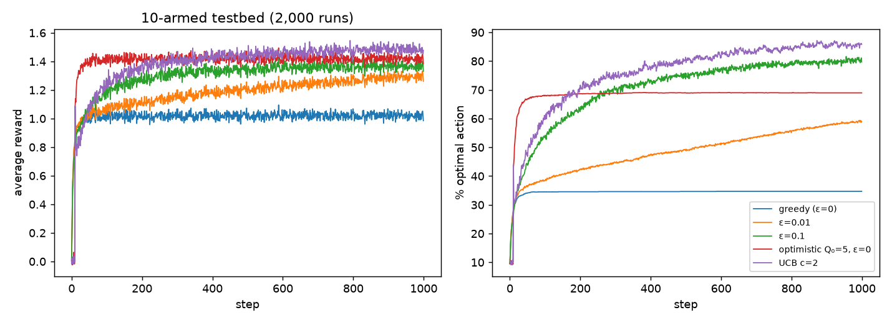</p>

**Bellman equation, checked numerically** (FrozenLake 4×4, random policy, γ = 0.9): the linear-system solution and 79 sweeps of iterative evaluation agree to 2.7 × 10⁻¹². Each sweep shrinks the error by at most a factor of **0.776**, inside the γ = 0.9 contraction bound.

### Week 3: Dynamic programming and TD learning
| FrozenLake (slippery, γ = 0.99) | Policy iteration | Value iteration | Same v*? | Optimal success rate |
|---|---|---|---|---|
| 4×4 | 3 steps | 571 sweeps | ✔ (max diff 2.8 × 10⁻⁹) | 72.9% |
| 8×8 | 3 steps | 662 sweeps | ✔ (max diff 3.1 × 10⁻⁹) | 62.7% |

<p align="center">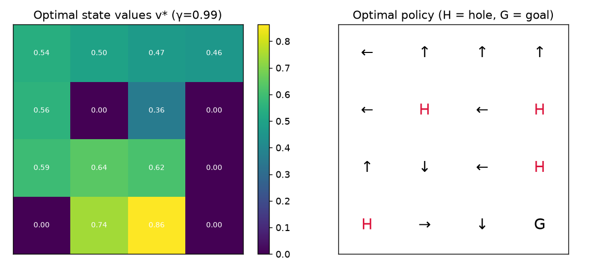 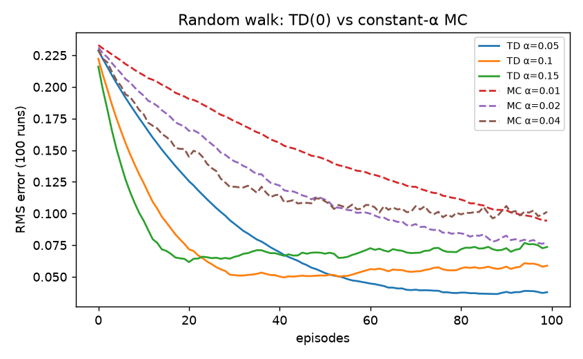</p>

On the 5-state random walk, **TD(0) reaches an RMS error of 0.038 vs 0.077 for the best Monte-Carlo setting**, 51% lower with the same data.

### Week 4: Q-learning vs SARSA
| Environment | Value iteration (optimal) | Q-learning | SARSA |
|---|---|---|---|
| FrozenLake 4×4: success rate | 0.729 | 0.734 ± 0.004 | 0.727 ± 0.001 |
| Taxi: return | 7.91 | **7.91 ± 0.00** | 7.72 ± 0.09 |
| CliffWalking: return | −13 | **−13 ± 0** (cliff-edge path) | −17 ± 0 (safe path) |

SARSA learns the value of the ε-greedy policy it actually follows, so it avoids the cliff edge where exploration could throw it off. Q-learning learns the optimal, riskier path.

<p align="center"> </p>

### Week 5: DQN, tuning and ablation
**Ablation** (CartPole-v1, 60k steps):

| Variant | Training return | Greedy eval |
|---|---|---|
| DQN (replay + target network) | 292.6 ± 101.2 | 254.7 ± 178.4 |
| **Double DQN** | 265.2 ± 42.1 | **447.2 ± 40.4** |
| No replay buffer | 165.3 ± 69.4 | 139.4 ± 24.0 |
| **No target network** | **9.3 ± 0.1** | **9.2 ± 0.1** (diverged: Q ≈ 8.4 × 10⁶) |

**Hyperparameter sensitivity**, one change at a time from the default (ε decays over 20% of steps, batch 64, target update every 500 steps):

| Setting | Training return | Greedy eval | Seeds that solved* |
|---|---|---|---|
| default | 247.3 ± 82.7 | 377.2 ± 163.7 | 0/3 |
| **ε-decay over 10% of steps** | **391.0 ± 82.8** | **429.4 ± 99.8** | 1/3 |
| ε-decay over 50% of steps | 86.2 ± 14.9 | 223.7 ± 196.0 | 0/3 |
| batch 32 | 214.2 ± 109.1 | 252.2 ± 172.8 | 0/3 |
| batch 128 | 237.4 ± 164.2 | 252.1 ± 176.9 | 1/3 |
| **target update every 100** | 353.8 ± 113.5 | 364.7 ± 179.5 | **2/3** |
| target update every 2000 | 153.3 ± 22.0 | 150.4 ± 36.2 | 0/3 |

\*20-episode moving average ≥ 475.

- **Exploration schedule and target-update period matter most.** Decaying ε too slowly keeps the agent random for too long. A very stale target network (every 2,000 steps) slows learning.
- **Batch size mattered less than seed-to-seed variation.**
- DQN exploration actions are not seeded, so reruns of the same configuration differ (compare the "default" row with the ablation's first row). The large ± values are themselves a finding: **DQN on CartPole is highly seed-sensitive**.

<p align="center">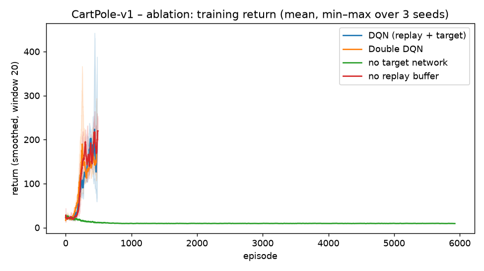 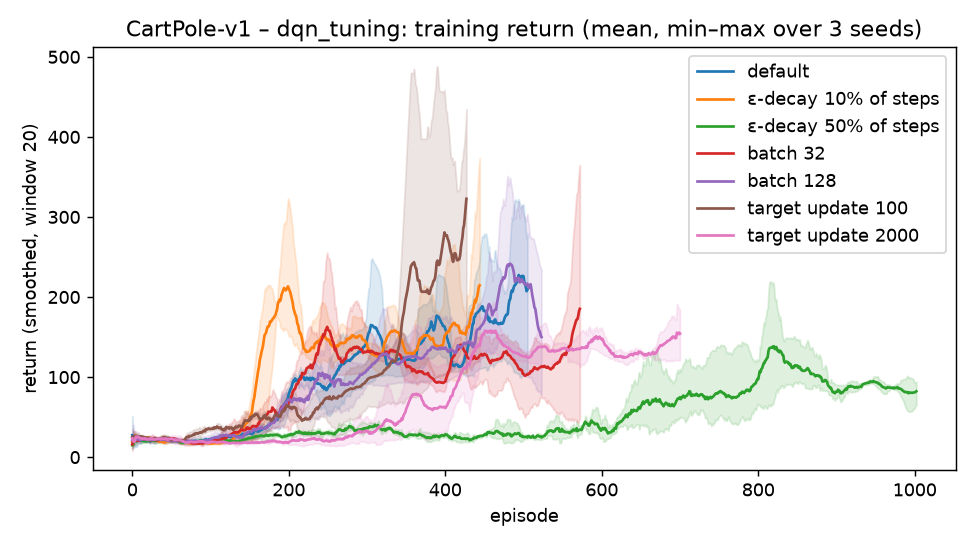</p>

### Week 6: Policy gradients
| CartPole-v1 | Training return | Greedy eval | Seeds solved | Median steps to solve |
|---|---|---|---|---|
| DQN | 235.7 ± 24.4 | 235.1 ± 70.6 | 1/3 | 26.5k (1 seed) |
| REINFORCE, no baseline | 392.5 ± 132.1 | 400.1 ± 141.0 | 3/3 | 55.6k |
| REINFORCE + learned baseline | 418.4 ± 60.2 | **500.0 ± 0.0** | 3/3 | 56.8k |
| A2C | 299.7 ± 119.6 | 387.8 ± 158.7 | 2/3 | 80.9k |
| **PPO** | **500.0 ± 0.0** | **500.0 ± 0.0** | **3/3** | **38.7k** |

**Gradient-variance measurement** (500 sampled episodes per policy): the learned baseline lowers the trace of the REINFORCE gradient covariance by **28.0%** for an early policy and **53.7%** for a near-solved one, with cosine similarity 1.000 / 0.993 between the mean gradients. Same expected gradient, much less noise. With the baseline, all 3 seeds end at a perfect greedy policy. Without it, one seed finishes at about 200.

<p align="center">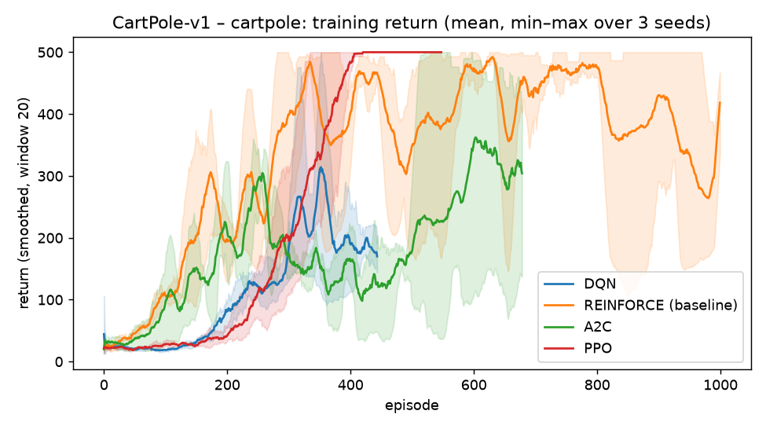 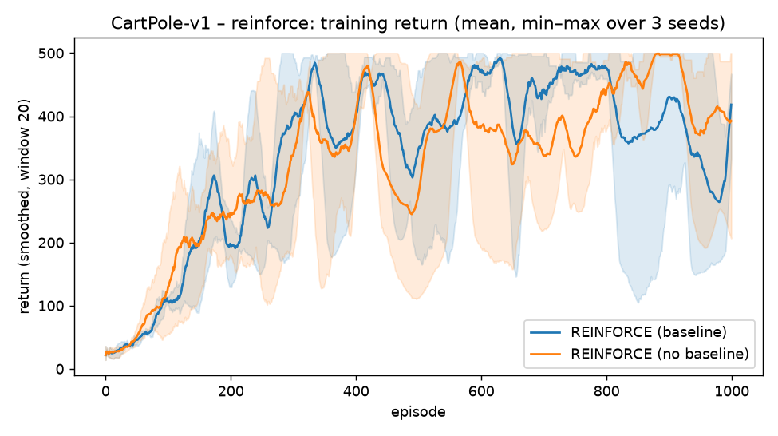</p>

**LunarLander-v3** (solved at ≥ 200):

| Algorithm (budget) | Training return | Greedy eval | Seeds solved (greedy ≥ 200) |
|---|---|---|---|
| A2C (1M steps) | −28.1 ± 13.3 | 8.9 ± 24.0 | 0/3 |
| REINFORCE + baseline (3,000 episodes) | 133.0 ± 67.1 | 107.5 ± 60.9 | 0/3 |
| **PPO (1M steps)** | **203.0 ± 58.0** | **245.0 ± 25.8** | **3/3** |

On the harder task the gap between the methods opens up. Single-environment A2C, with one gradient step per 16-step rollout, barely leaves the "hover and crash" phase. REINFORCE learns to land on some seeds but is noisy. PPO's clipped multi-epoch updates make it the only method that solves LunarLander on every seed. A2C would need parallel environments and tuning to be competitive.

<p align="center">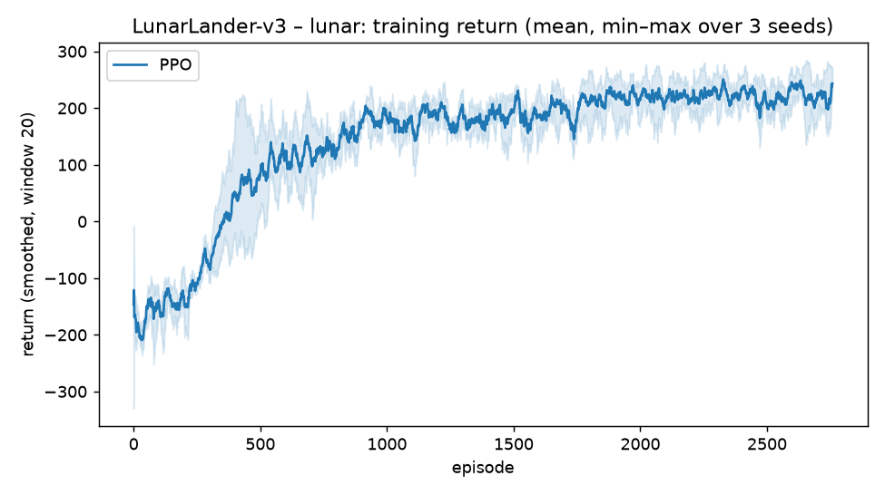 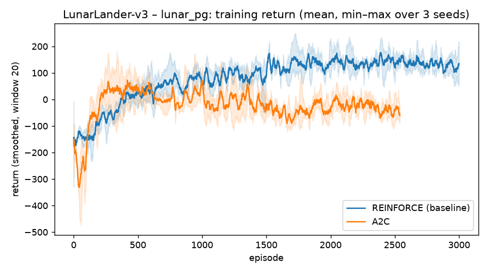</p>

### Week 7: DDPG, RLHF and MARL
- **DDPG on Pendulum-v1** (30k steps): greedy return **−146.7 ± 2.3**. The pendulum swings up and balances; a random policy scores about −1200.
- **RLHF:** a Bradley–Terry reward model learned from simulated pairwise preferences ranks 72% of 190 response pairs correctly from 50 comparisons, and **96.7%** from 5,000. The KL-regularised policy $\pi \propto \pi_\text{ref} e^{\hat r/\beta}$ raises the true expected reward from −0.18 to 0.41 at β = 1 (KL = 0.28 nats).
- **MARL:** independent Q-learners in the prisoner's dilemma defect 95% of the time, the (D, D) Nash equilibrium. Fictitious play in matching pennies converges to the mixed equilibrium (0.498, 0.498).

<p align="center">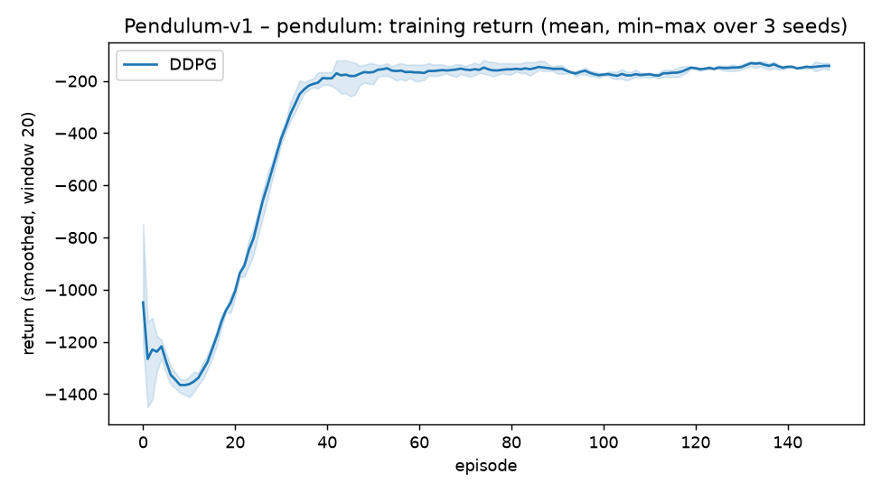 </p>

---

## Repository layout
```
theory/        week-by-week notes: definitions, derivations, links to code and results
rl/
  bandits.py           k-armed testbed: ε-greedy, optimistic init, UCB
  dp.py                MDP matrices, exact and iterative policy evaluation, policy iteration
  td.py                TD(0) vs constant-α MC prediction (random walk)
  tabular.py           value iteration, Q-learning, SARSA
  dqn.py               DQN / Double DQN, replay buffer, target network (ablation flags)
  policy_gradient.py   REINFORCE (± baseline), A2C, PPO (clipped objective, GAE)
  ddpg.py              DDPG with Polyak-averaged targets
  rlhf.py              Bradley–Terry reward model, KL-regularised policy
  marl.py              Nash equilibria, independent Q-learning, fictitious play
scripts/
  run_foundations.py   weeks 2, 3, 7 (bandits, Bellman, DP, TD, RLHF, MARL): ~15 s
  run_tabular.py       week 4: ~3 min
  run_deep.py          weeks 5–8: cartpole | ablation | dqn_tuning | reinforce | pendulum | lunar | lunar_pg | all
  pg_variance.py       week 6 gradient-variance measurement
  sample_efficiency.py steps-to-solve from saved learning curves
results/       every plot, summary CSV/JSON and raw per-episode returns
```

## Reproduce
```bash
python -m venv .venv
.venv\Scripts\activate                 # Windows   (source .venv/bin/activate on Linux/macOS)
pip install -r requirements.txt
python scripts/run_foundations.py
python scripts/run_tabular.py
python scripts/run_deep.py all         # about 1–1.5 h on a 16-core CPU
python scripts/pg_variance.py
python scripts/sample_efficiency.py
```

## References
Sutton & Barto, *Reinforcement Learning: An Introduction* (2nd ed.) · Mnih et al. 2015 (DQN) · van Hasselt et al. 2016 (Double DQN) · Schulman et al. 2016 (GAE), 2017 (PPO) · Lillicrap et al. 2016 (DDPG) · Christiano et al. 2017 (RL from human preferences) · Albrecht, Christianos & Schäfer, *Multi-Agent Reinforcement Learning* · Lilian Weng, *A (Long) Peek into RL*

---
Manas Jagtap · Dual Degree, Electrical Engineering, IIT Bombay
