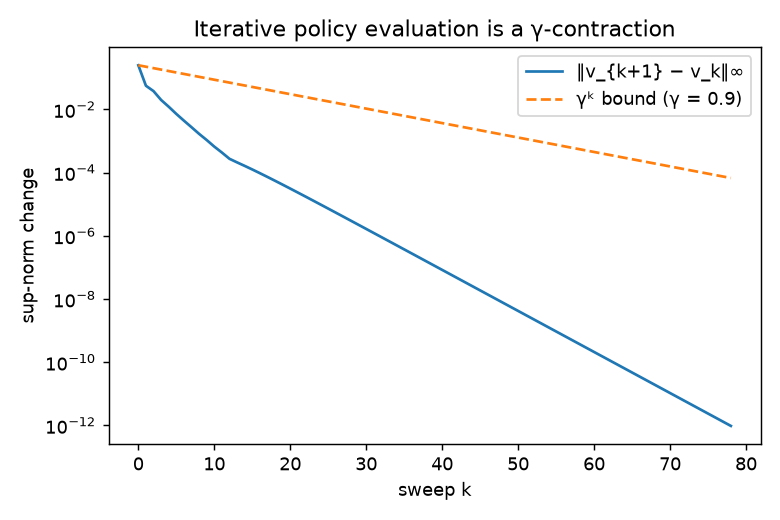

# Week 2: MDPs, Bellman equations and multi-armed bandits

## Markov decision processes
An MDP is a tuple $(\mathcal{S}, \mathcal{A}, p, r, \gamma)$ with dynamics $p(s', r \mid s, a)$. The **Markov property** says the future depends on the past only through the present state:
$\Pr(S_{t+1}, R_{t+1} \mid S_t, A_t, S_{t-1}, \dots) = \Pr(S_{t+1}, R_{t+1} \mid S_t, A_t)$.

## Bellman expectation equation
Write $G_t = R_{t+1} + \gamma G_{t+1}$ and condition on $A_t$ and then $S_{t+1}$ (law of total expectation):

$$v_\pi(s) = \sum_a \pi(a \mid s) \sum_{s', r} p(s', r \mid s, a)\,\big[r + \gamma\, v_\pi(s')\big].$$

In matrix form, with $P_\pi[s,s'] = \sum_a \pi(a \mid s)\,p(s' \mid s,a)$ and $r_\pi[s] = \sum_a \pi(a \mid s)\,r(s,a)$:

$$v_\pi = r_\pi + \gamma P_\pi v_\pi \quad\Longrightarrow\quad v_\pi = (I - \gamma P_\pi)^{-1} r_\pi .$$

$I - \gamma P_\pi$ is invertible for $\gamma < 1$, because $P_\pi$ is (sub-)stochastic, so its spectral radius is at most 1.

### The Bellman operator is a γ-contraction
Define $(T_\pi v)(s) = r_\pi(s) + \gamma (P_\pi v)(s)$. For any $u, v$:

$$\|T_\pi u - T_\pi v\|_\infty = \gamma \|P_\pi (u - v)\|_\infty \le \gamma \|u - v\|_\infty ,$$

since each row of $P_\pi$ is a probability vector. By the Banach fixed-point theorem, iterating $v_{k+1} = T_\pi v_k$ from any $v_0$ converges to the unique fixed point $v_\pi$, with error at most $\gamma^k \|v_0 - v_\pi\|_\infty$.

**Verified numerically** (`scripts/run_foundations.py`, FrozenLake 4×4, uniform random policy, γ = 0.9):
- The closed-form solve and iterative evaluation agree to $2.7 \times 10^{-12}$ after 79 sweeps.
- The worst observed per-sweep ratio $\|v_{k+1}-v_k\| / \|v_k - v_{k-1}\|$ is **0.776 ≤ γ = 0.9**. It is below γ because some probability mass is absorbed in the holes and goal.

## Bellman optimality equation
$$v_*(s) = \max_a \sum_{s', r} p(s', r \mid s, a)\big[r + \gamma v_*(s')\big], \qquad q_*(s,a) = \sum_{s', r} p(s', r \mid s, a)\big[r + \gamma \max_{a'} q_*(s', a')\big].$$

The max makes the operator non-linear, but it is still a γ-contraction (using $|\max f - \max g| \le \max |f - g|$). That is why value iteration converges (Week 3).

## Multi-armed bandits (`rl/bandits.py`)
A one-state MDP: each of *k* arms has an unknown mean reward $q_*(a)$. Estimates use the incremental sample average

$$Q_{n+1} = Q_n + \frac{1}{n}\big(R_n - Q_n\big) \qquad (\text{new estimate} = \text{old} + \text{step size} \times \text{error}),$$

the same "target − estimate" pattern used by every TD method later.

| Strategy | Rule | 10-armed testbed: % optimal action (steps 900–1000) | Avg reward |
|---|---|---|---|
| Greedy | $\arg\max_a Q(a)$ | 34.7% | 1.02 |
| ε-greedy, ε = 0.01 | random arm with prob. ε | 58.4% | 1.29 |
| **ε-greedy, ε = 0.1** | random arm with prob. ε | **80.0%** | 1.37 |
| Optimistic $Q_0 = 5$, greedy | optimism drives early exploration | 68.9% | 1.42 |
| **UCB, c = 2** | $\arg\max_a \big[Q(a) + c\sqrt{\ln t / N(a)}\big]$ | **85.6%** | **1.49** |

(2,000 independent runs × 1,000 steps.) Pure greedy locks onto a sub-optimal arm in about two thirds of runs. A little exploration more than doubles the optimal-action rate. UCB explores *directionally*, towards uncertain arms, and does best.

*Reading: Sutton & Barto, Ch. 2–3.*
