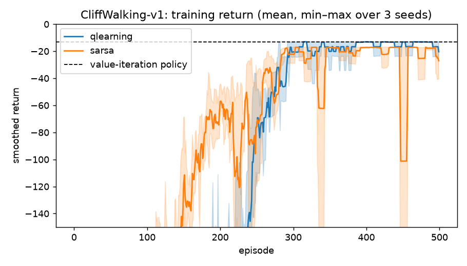
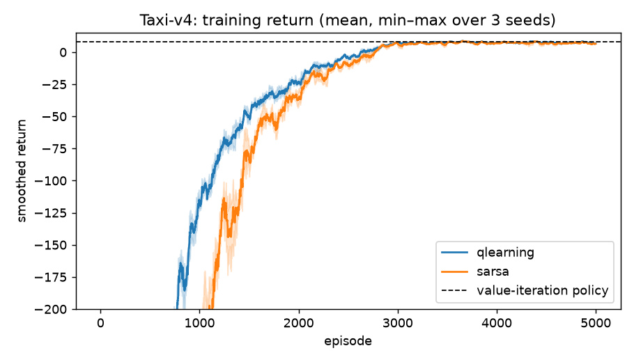

# Week 4: Q-learning and tabular control

Control means learning **action values**, so that acting greedily needs no model: $\pi(s) = \arg\max_a Q(s,a)$.

| | SARSA (on-policy) | Q-learning (off-policy) |
|---|---|---|
| Update target | $R_{t+1} + \gamma Q(S_{t+1}, A_{t+1})$ | $R_{t+1} + \gamma \max_{a'} Q(S_{t+1}, a')$ |
| Learns the value of | the ε-greedy policy it follows | the greedy (optimal) policy |
| Converges to | $q_\pi$ of the behaviour policy (→ $q_*$ as ε → 0) | $q_*$, under standard step-size conditions |

Both converge under the Robbins–Monro conditions $\sum_t \alpha_t = \infty$ and $\sum_t \alpha_t^2 < \infty$, provided every state-action pair keeps being visited. Code: `rl/tabular.py`, with linearly decaying ε and random tie-breaking in `argmax`.

## Results (3 seeds, greedy evaluation; `scripts/run_tabular.py`)

| Environment | Value iteration (optimal) | Q-learning | SARSA |
|---|---|---|---|
| FrozenLake 4×4, slippery: success rate | 0.729 | 0.734 ± 0.004 | 0.727 ± 0.001 |
| Taxi: return | 7.91 | **7.91 ± 0.00** | 7.72 ± 0.09 |
| CliffWalking: return | −13 | **−13 ± 0** | −17 ± 0 |

### Why SARSA walks the long way on CliffWalking
Stepping off the cliff costs −100. Q-learning's target uses the *max* over next actions, so it ignores the chance that exploration pushes it off the edge. It learns the optimal edge path (13 steps, −13). SARSA's target uses the action actually taken, including ε-random ones, so cells next to the cliff look dangerous and it learns a safer path one row up (−17). Neither is "wrong": SARSA optimises the policy it actually runs, Q-learning the one it would run without exploration.

 

### Limitations that motivate DQN
A Q-table needs one entry per (state, action). Taxi has 500 states, but CartPole's state is four continuous numbers and Atari's is 84×84×4 pixels. We need **function approximation**, $Q(s,a;\theta)$, which generalises across similar states.
