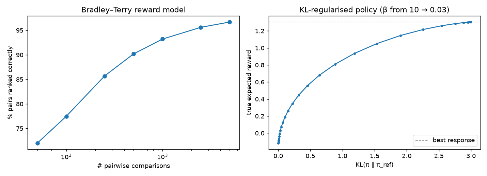
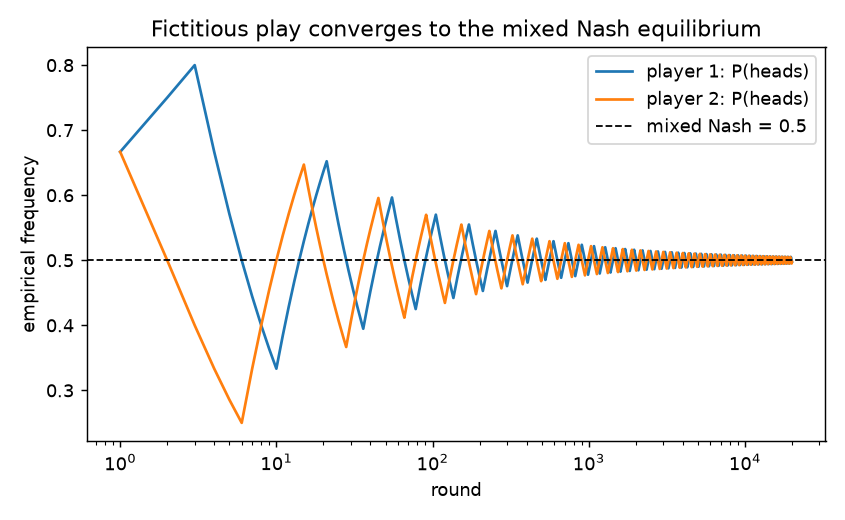

# Week 7: DDPG, RLHF and multi-agent RL

## DDPG: continuous actions (`rl/ddpg.py`)
DQN needs $\max_a Q(s,a)$, which is intractable for continuous *a*. DDPG learns a **deterministic actor** $\mu_\phi(s)$ that approximates the argmax, trained by the deterministic policy gradient:

$$\nabla_\phi J \approx \mathbb{E}_s\big[\nabla_a Q(s, a; \theta)\big|_{a = \mu_\phi(s)}\, \nabla_\phi \mu_\phi(s)\big].$$

In code this is just `actor_loss = −Q(s, μ(s)).mean()`.

- **Critic target:** $y = r + \gamma (1 - d)\,Q'(s', \mu'(s'))$, using target networks updated by Polyak averaging, $\theta' \leftarrow \tau\theta + (1-\tau)\theta'$ with τ = 0.005.
- **Exploration:** Gaussian noise on the action, since a deterministic policy never explores on its own.
- **Pendulum-v1** (30k steps, 3 seeds): greedy return **−146.7 ± 2.3**. The pendulum swings up and balances; a random policy scores roughly −1200.

## RLHF: Reinforcement Learning from Human Feedback (`rl/rlhf.py`)
Used to align large language models. There are three stages: supervised fine-tuning → **reward model from human preferences** → **RL against that reward with a KL penalty**. The toy version here keeps the two RL-specific ideas, with "responses" represented as 20 arms with hidden true quality.

**1. Bradley–Terry reward model.** Humans compare two responses. We model $P(i \succ j) = \sigma(r_i - r_j)$ and fit $\hat r$ by maximising the log-likelihood $\sum \log \sigma(\hat r_w - \hat r_l)$, which is logistic regression on reward differences. Rewards are identifiable only up to a constant.

| # comparisons | 50 | 100 | 250 | 500 | 1,000 | 2,500 | 5,000 |
|---|---|---|---|---|---|---|---|
| % of response pairs ranked correctly | 72.0 | 77.5 | 85.7 | 90.2 | 93.2 | 95.6 | **96.7** |

**2. KL-regularised policy.** Maximising $\mathbb{E}_\pi[\hat r] - \beta\,\mathrm{KL}(\pi \,\|\, \pi_\text{ref})$ has the closed-form solution
$\pi^*(a) \propto \pi_\text{ref}(a)\,\exp(\hat r(a) / \beta)$. (Derivation: the objective equals $-\beta\,\mathrm{KL}(\pi \,\|\, \pi^*)$ + const.) The KL term keeps the policy close to the reference model. That limits **reward hacking**, i.e. over-exploiting errors in $\hat r$. At β = 1 the true expected reward rises from −0.18 (reference) to **0.41**, for KL = 0.28 nats. Smaller β moves along the curve towards the best response.

## Multi-agent RL and game theory 101 (`rl/marl.py`)
With several learners, each agent's environment is **non-stationary**, because the other agents are learning too. The solution concept becomes the **Nash equilibrium**: no player can gain by changing strategy unilaterally.

| Game | Pure Nash | Mixed Nash (indifference conditions) | Learning result |
|---|---|---|---|
| Prisoner's dilemma | (Defect, Defect) | none | Independent Q-learners defect **95%** of the time (ε = 0.1 exploration accounts for the rest), even though (C, C) pays both players more |
| Matching pennies | none | each plays heads with p = 0.5 | **Fictitious play** converges to empirical frequencies of 0.498 / 0.498 |

The mixed equilibrium comes from making the opponent indifferent: if player 2 plays heads with prob. *q*, then player 1 is indifferent when $q A_{00} + (1-q) A_{01} = q A_{10} + (1-q) A_{11}$, which gives $q = 1/2$.

*Reading: Lillicrap et al., DDPG (2016); Christiano et al., "Deep RL from Human Preferences" (2017); Ouyang et al., InstructGPT (2022); Albrecht, Christianos & Schäfer, "Multi-Agent Reinforcement Learning" (MARL Book), Ch. 1–4; Shimon Whiteson's MARL seminar.*
